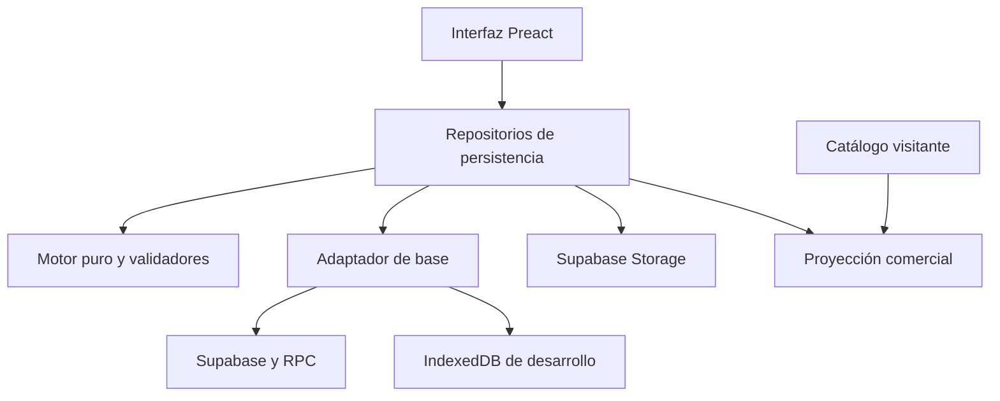

# Arquitectura y mapa del código

Referencia del código publicado el 19/10/2026. Para requisitos completos leer
[ESPECIFICACION.md](../ESPECIFICACION.md); para cambios posteriores,
[ESTADO.md](../ESTADO.md). Esta guía explica responsabilidades, no sustituye el motor.

## Producto y entornos

Candelaria es una PWA para costear velas, administrar catálogo y registrar pedidos.
Un creador autenticado administra; los visitantes ven únicamente la proyección
comercial de combos. La interfaz tiene Vender, Pedidos, Productos y Ajustes.
Productos contiene solapas para combos, productos e insumos.

| Ubicación | Responsabilidad |
|---|---|
| `D:/Colo/Candelaria` | Repositorio y aplicación vigente. |
| `D:/Maira/App Velas` | Planilla y documentos históricos, referencias y revisión. |
| GitHub Pages `/Candelaria/` | Frontend público; rutas con `#/...`. |
| Supabase | Autenticación, datos vigentes, políticas y fotos. |
| Local sin configuración remota | IndexedDB del origen de prueba; fixtures sólo con DEV e insumos/productos/combos/pedidos vacíos. |

Las dos carpetas locales corresponden al mismo producto. La segunda no contiene
otro backend ni una base que deba sincronizarse automáticamente con producción.

## Dónde cambiar cada cosa

| Ruta | Qué contiene |
|---|---|
| `src/config` | Parámetros iniciales, validador, roles fijos, formato, plantillas y cliente Supabase. |
| `src/motor` | Costos, redondeos, indicadores y desglose. Sin UI ni acceso a base. |
| `src/persistencia/db.js` | Adaptación camelCase/SQL, CRUD, transacciones locales y RPC remotas. |
| `src/persistencia/catalogoRepo.js` | Resolución de roles, costo calculado y caché del catálogo. |
| `src/persistencia/pedidoLogica.js` | Reglas puras de pedidos, pagos, entrega e historial. |
| `src/persistencia/pedidosRepo.js` | Lectura con derivados y escritura transaccional de pedidos. |
| `src/persistencia/catalogoPublicoRepo.js` | Construcción, lectura y publicación comercial. |
| `src/persistencia/respaldo.js` | JSON, medios, validación y restauración. |
| `src/persistencia/excel*` | Contrato, XLSX/CSV, revisión y aplicación de cambios. ExcelJS es dinámico. |
| `src/persistencia/importadorFuente.js`, `xlsxLectura.js` | Lectura de la planilla original; no confundir con intercambio XLSX del catálogo vigente. |
| `src/interfaz/main.jsx`, `AuthGate.jsx` | Arranque, acceso, aviso de publicación y registro PWA. |
| `src/interfaz/App.jsx`, `enrutador.js` | Pantallas, rutas hash, sección activa y guardas. |
| `src/interfaz/pantallas` | Flujos de cada pantalla; `comun` contiene componentes compartidos. |
| `src/hooks` | Advertencias de cambios sin guardar y sus utilidades. |
| `src/estilos` | Tokens, componentes, fuentes locales y guardianes visuales. |
| `src/desarrollo`, `fixtures_*` | Datos históricos y siembra para pruebas/desarrollo. |
| `public` | Worker, manifest e íconos. |
| `supabase` | Instalación nueva, actualizaciones y pruebas SQL aisladas. |
| `.github/workflows/deploy.yml` | Pruebas, build, control de artefactos y GitHub Pages. |
| `.claude` | Adaptadores y hooks de Claude; la entrada común es AGENTS.md. |

## Datos y contratos que no se deben romper

Cinco colecciones privadas: `insumos`, `productos`, `combos`, `parametros`,
`pedidos`. `db.js` transforma, por ejemplo, `rolMotor` a `rol_motor`, los campos
comerciales del combo a snake_case y los parámetros a la columna JSON `datos`.
No pasar registros de SQL directamente a componentes o validadores del dominio.

- Insumo: identidad/código, nombre, unidad, compra, estado y rol del motor opcional.
- Producto: receta fija, costo de recipiente o herencia, extras, fotos y estado.
- Combo: identidad independiente, nombre interno, campos comerciales, líneas de
  producto/insumo con cantidad y fotos. Los nuevos usan UUID; conservar IDs antiguos.
- Parámetros: registro `actuales`, combinado con valores iniciales al leer.
  Puede no haber fila persistida. Incluye plantillas centrales y teléfono opcional.
- Pedido: líneas con nombres y precios congelados, pagos e historial y `revision`.
  `total`, `pagado`, `saldo` y estado de cobro se derivan, no se guardan como verdad.

Los roles de cera, pabilo, yeso, esencia, colorante y coco están centralizados en
`config/insumosFijos.js`. El catálogo reconoce datos antiguos sin reescribirlos;
al editar, se conserva el rol antes de cambiar un nombre. No volver a vincular
el cálculo exclusivamente por texto visible.

El detalle del cálculo está en `motor/calculo.js` y sus pruebas. Respetar la
conversión del yeso de gramos a costo por kilogramo, la esencia sobre cera y la
diferencia entre redondeo de costo y de precio. No reconstruir fórmulas en JSX.

## Escritura, concurrencia y publicación

`crear` rechaza duplicados y `actualizar` exige existencia. El guardado genérico
queda para mecanismos internos compatibles; no usarlo para nuevas altas de UI.
Los pedidos se guardan por `guardar_pedido_seguro`: numeración dentro de la
transacción y comparación de revisión. La UI debe usar la revisión devuelta.
No reintentar una copia obsoleta sobre el pedido vigente.

Después de cambiar catálogo/parámetros: invalidar caché y publicar. Un fallo de
publicación conserva el dato privado guardado y ofrece reintento. No repetir el
alta ni bloquear el acceso de reparación porque falle el cálculo público.

`catalogo_publico_combos` es una tabla derivada. Publica nombre, descripción,
precio, fotos, estado y teléfono opcional. No leer tablas privadas desde el
catálogo visitante. La descripción de reserva usa sólo nombres de productos
terminados, nunca insumos ni mano de obra. El campo comercial explícito requiere
revisión del creador: no es un detector automático de información privada.

JSON restaura el conjunto de datos con comparación del estado previo. Storage
se prepara antes de la transacción; una falla puede dejar objetos sin referencia,
pero no se borran imágenes previas. XLSX modifica sólo catálogo/parámetros,
conserva registros omitidos y no importa pedidos. Ver la guía de operación.

## Rutas, estado transitorio y PWA

Las rutas se definen en `App.jsx`: `vender`, `pedidos`, `productos`, `ajustes`,
`producto/:id`, `pedido/:id`, `pago/:id`, `mensaje/:id`, altas/ediciones y plantillas.
Usar el enrutador para codificar IDs, mantener origen/filtro y respetar guardas.
Altas y ediciones ocultan la navegación inferior.

El borrador de venta vive en `sessionStorage`, por usuario y pestaña, durante
ocho horas sin cambios. No es un pedido ni un respaldo ni sincronización remota.
Las plantillas antiguas en `localStorage` son una transición, no la fuente central.

Worker con cachés propias `candelaria-*`, base `/Candelaria/`, reserva HTML sólo
para navegación y Excel fuera del precaché. La versión documentada tras el
buscador es v6. Un cambio futuro debe conservar el aviso de actualización y no
borrar cachés ajenas. Poder abrir la carcasa offline no permite guardar en Supabase offline.
